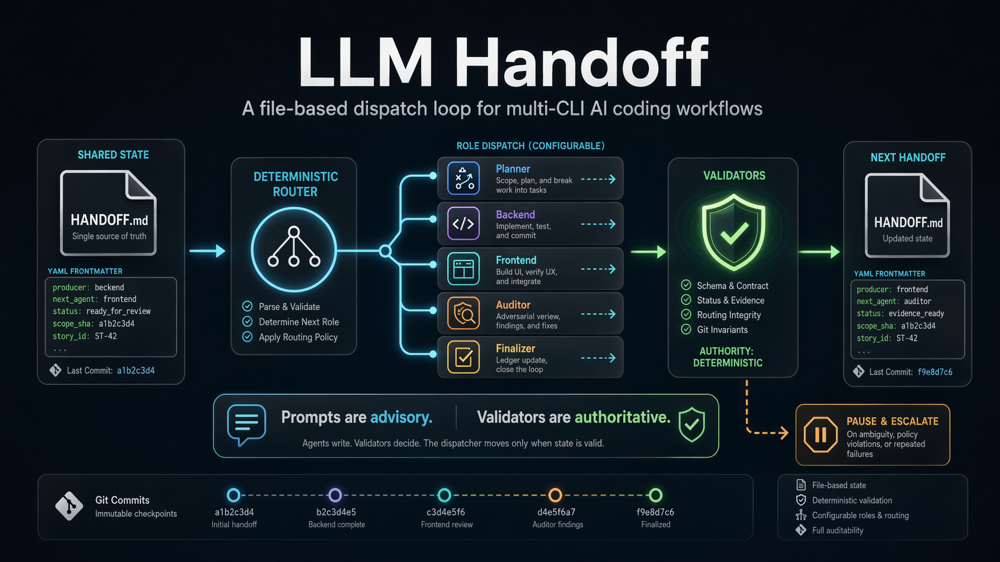

# llm-handoff

[](LICENSE)

`llm-handoff` is a reference implementation of a file-based dispatch loop for
multi-CLI AI coding workflows.

The design principle is simple:

> Prompts are advisory. Validators are authoritative.

Agents can write prose, but the dispatcher only advances when the handoff state
parses, routes, and validates. A single Markdown file is the shared state file.
Git commit SHAs are the durable record of completed work. When routing is
ambiguous or unsafe, the dispatcher fails closed and pauses instead of guessing.

Built for solo developers coordinating multiple agent CLIs on a single repo
without the overhead of git worktrees, pull-request choreography, or a service
orchestrator.



## Status

This repository is in pre-release extraction. The dispatcher is being
genericized from a project-specific implementation into a public reference
workflow. Expect names, configuration, and examples to change until the first
tagged release.

This is still pre-release software, not a production-certified tool for
arbitrary repositories. See [CHANGELOG.md](CHANGELOG.md) for the extraction
state.

## Repository Map

All Markdown documentation and shipped Markdown prompt artifacts are linked
here. Test fixture handoffs are included in a collapsed section because they
are parser fixtures, not user-facing docs.

### Core Docs

| File | Purpose |
| --- | --- |
| [README.md](README.md) | Public front door and project positioning. |
| [QUICKSTART.md](QUICKSTART.md) | Short source-checkout path for a first dry run. |
| [WALKTHROUGH.md](WALKTHROUGH.md) | Longer first-run guide explaining source and target repo flow. |
| [INSTALL.md](INSTALL.md) | Install paths, provider CLI checks, and first run. |
| [CONFIGURATION.md](CONFIGURATION.md) | Supported `dispatch_config.yaml` surface. |
| [docs/ARCHITECTURE.md](docs/ARCHITECTURE.md) | Module map and design choices. |
| [docs/SUPERVISED_DISPATCH.md](docs/SUPERVISED_DISPATCH.md) | Optional supervisor wrapper, heartbeats, incident bundles, and bounded repair role. |
| [docs/TESTING.md](docs/TESTING.md) | Test strategy and current scaffold state. |
| [AGENTS.md](AGENTS.md) | Instructions for coding agents working in this repo. |
| [CONTRIBUTING.md](CONTRIBUTING.md) | Contribution scope and project boundaries. |
| [SECURITY.md](SECURITY.md) | Safe usage and vulnerability reporting. |
| [CHANGELOG.md](CHANGELOG.md) | Release and extraction history. |

### Runtime And Examples

| File | Purpose |
| --- | --- |
| [dispatch_config.example.yaml](dispatch_config.example.yaml) | Example role-to-provider config shape. |
| [.pre-commit-config.yaml](.pre-commit-config.yaml) | Lightweight contributor hooks for whitespace, YAML/TOML, large files, and Ruff. |
| [pyproject.toml](pyproject.toml) | Package metadata, runtime dependencies, and the `llm-handoff` console command. |
| [requirements-dev.txt](requirements-dev.txt) | Source-checkout runtime and test dependencies. |
| [examples/reference-workflow/README.md](examples/reference-workflow/README.md) | Copyable workflow protocol plan. |

### Handoff Protocol

| File | Purpose |
| --- | --- |
| [docs/handoff/README.md](docs/handoff/README.md) | Handoff directory guide and schema summary. |
| [docs/handoff/HANDOFF.md](docs/handoff/HANDOFF.md) | Placeholder live handoff template. |
| [docs/handoff/HANDBOOK.md](docs/handoff/HANDBOOK.md) | Shared handoff operating rules for all roles. |
| [docs/handoff/SHARED_REPO_INIT_PROMPT.md](docs/handoff/SHARED_REPO_INIT_PROMPT.md) | Shared startup prompt for roles. |
| [docs/handoff/PLANNER_INITIAL_PROMPT.md](docs/handoff/PLANNER_INITIAL_PROMPT.md) | First planner prompt for new workflows. |
| [docs/handoff/PLANNER_HANDOFF_PROMPT.md](docs/handoff/PLANNER_HANDOFF_PROMPT.md) | Planner handoff prompt. |
| [docs/handoff/BACKEND_HANDOFF_PROMPT.md](docs/handoff/BACKEND_HANDOFF_PROMPT.md) | Backend role prompt. |
| [docs/handoff/FRONTEND_HANDOFF_PROMPT.md](docs/handoff/FRONTEND_HANDOFF_PROMPT.md) | Frontend role prompt. |
| [docs/handoff/AUDITOR_HANDOFF_PROMPT.md](docs/handoff/AUDITOR_HANDOFF_PROMPT.md) | Auditor role prompt. |
| [docs/handoff/FINALIZER_HANDOFF_PROMPT.md](docs/handoff/FINALIZER_HANDOFF_PROMPT.md) | Finalizer role prompt. |

### Provider Agent Templates

| File | Purpose |
| --- | --- |
| [.codex/skills/llm-handoff/SKILL.md](.codex/skills/llm-handoff/SKILL.md) | Codex backend skill bootstrap. |
| [.gemini/agents/planner.md](.gemini/agents/planner.md) | Gemini planner agent template. |
| [.gemini/agents/frontend.md](.gemini/agents/frontend.md) | Gemini frontend agent template. |
| [.claude/agents/auditor.md](.claude/agents/auditor.md) | Claude auditor agent template. |
| [.claude/agents/handoff-router.md](.claude/agents/handoff-router.md) | Claude routing clarification agent. |
| [.claude/agents/handoff-validator.md](.claude/agents/handoff-validator.md) | Claude handoff validator agent. |
| [.claude/agents/ledger-updater.md](.claude/agents/ledger-updater.md) | Claude finalizer compatibility agent. |

<details>
<summary>Reference Workflow Template Markdown</summary>

| File | Purpose |
| --- | --- |
| [examples/reference-workflow/AGENTS.md](examples/reference-workflow/AGENTS.md) | Target-repo agent instructions template. |
| [examples/reference-workflow/PROJECT_STATE.md](examples/reference-workflow/PROJECT_STATE.md) | Target-repo durable state template. |
| [examples/reference-workflow/docs/handoff/README.md](examples/reference-workflow/docs/handoff/README.md) | Template handoff directory guide. |
| [examples/reference-workflow/docs/handoff/HANDOFF.md](examples/reference-workflow/docs/handoff/HANDOFF.md) | Template starter handoff. |
| [examples/reference-workflow/docs/handoff/HANDBOOK.md](examples/reference-workflow/docs/handoff/HANDBOOK.md) | Template shared handoff handbook. |
| [examples/reference-workflow/docs/handoff/SHARED_REPO_INIT_PROMPT.md](examples/reference-workflow/docs/handoff/SHARED_REPO_INIT_PROMPT.md) | Template shared startup prompt. |
| [examples/reference-workflow/docs/handoff/PLANNER_INITIAL_PROMPT.md](examples/reference-workflow/docs/handoff/PLANNER_INITIAL_PROMPT.md) | Template first planner prompt. |
| [examples/reference-workflow/docs/handoff/PLANNER_HANDOFF_PROMPT.md](examples/reference-workflow/docs/handoff/PLANNER_HANDOFF_PROMPT.md) | Template planner prompt. |
| [examples/reference-workflow/docs/handoff/BACKEND_HANDOFF_PROMPT.md](examples/reference-workflow/docs/handoff/BACKEND_HANDOFF_PROMPT.md) | Template backend prompt. |
| [examples/reference-workflow/docs/handoff/FRONTEND_HANDOFF_PROMPT.md](examples/reference-workflow/docs/handoff/FRONTEND_HANDOFF_PROMPT.md) | Template frontend prompt. |
| [examples/reference-workflow/docs/handoff/AUDITOR_HANDOFF_PROMPT.md](examples/reference-workflow/docs/handoff/AUDITOR_HANDOFF_PROMPT.md) | Template auditor prompt. |
| [examples/reference-workflow/docs/handoff/FINALIZER_HANDOFF_PROMPT.md](examples/reference-workflow/docs/handoff/FINALIZER_HANDOFF_PROMPT.md) | Template finalizer prompt. |
| [examples/reference-workflow/.codex/skills/llm-handoff/SKILL.md](examples/reference-workflow/.codex/skills/llm-handoff/SKILL.md) | Template Codex backend skill. |
| [examples/reference-workflow/.gemini/agents/planner.md](examples/reference-workflow/.gemini/agents/planner.md) | Template Gemini planner agent. |
| [examples/reference-workflow/.gemini/agents/frontend.md](examples/reference-workflow/.gemini/agents/frontend.md) | Template Gemini frontend agent. |
| [examples/reference-workflow/.claude/agents/auditor.md](examples/reference-workflow/.claude/agents/auditor.md) | Template Claude auditor agent. |
| [examples/reference-workflow/.claude/agents/handoff-router.md](examples/reference-workflow/.claude/agents/handoff-router.md) | Template Claude router agent. |
| [examples/reference-workflow/.claude/agents/handoff-validator.md](examples/reference-workflow/.claude/agents/handoff-validator.md) | Template Claude validator agent. |
| [examples/reference-workflow/.claude/agents/ledger-updater.md](examples/reference-workflow/.claude/agents/ledger-updater.md) | Template Claude finalizer compatibility agent. |

</details>

<details>
<summary>Ported Test Fixture Markdown</summary>

| File | Purpose |
| --- | --- |
| [tests/ported/fixtures/handoffs/audit_story_close_next_story.md](tests/ported/fixtures/handoffs/audit_story_close_next_story.md) | Router fixture. |
| [tests/ported/fixtures/handoffs/legacy_backend_handback_story_close.md](tests/ported/fixtures/handoffs/legacy_backend_handback_story_close.md) | Router fixture. |
| [tests/ported/fixtures/handoffs/conflicting_signals.md](tests/ported/fixtures/handoffs/conflicting_signals.md) | Router fixture. |
| [tests/ported/fixtures/handoffs/empty.md](tests/ported/fixtures/handoffs/empty.md) | Router fixture. |
| [tests/ported/fixtures/handoffs/escalation.md](tests/ported/fixtures/handoffs/escalation.md) | Router fixture. |
| [tests/ported/fixtures/handoffs/legacy_manual_frontend_dispatch.md](tests/ported/fixtures/handoffs/legacy_manual_frontend_dispatch.md) | Router fixture. |
| [tests/ported/fixtures/handoffs/misroute.md](tests/ported/fixtures/handoffs/misroute.md) | Router fixture. |
| [tests/ported/fixtures/handoffs/next_step_header_epic_close.md](tests/ported/fixtures/handoffs/next_step_header_epic_close.md) | Router fixture. |
| [tests/ported/fixtures/handoffs/next_step_header_for_backend.md](tests/ported/fixtures/handoffs/next_step_header_for_backend.md) | Router fixture. |
| [tests/ported/fixtures/handoffs/next_step_qualifier_suffix_auditor.md](tests/ported/fixtures/handoffs/next_step_qualifier_suffix_auditor.md) | Router fixture. |
| [tests/ported/fixtures/handoffs/next_step_subheading_frontend.md](tests/ported/fixtures/handoffs/next_step_subheading_frontend.md) | Router fixture. |
| [tests/ported/fixtures/handoffs/no_signal.md](tests/ported/fixtures/handoffs/no_signal.md) | Router fixture. |
| [tests/ported/fixtures/handoffs/planner_task_assignment_backend.md](tests/ported/fixtures/handoffs/planner_task_assignment_backend.md) | Router fixture. |
| [tests/ported/fixtures/handoffs/prose_next_agent_planner_legacy_alias.md](tests/ported/fixtures/handoffs/prose_next_agent_planner_legacy_alias.md) | Router fixture. |
| [tests/ported/fixtures/handoffs/story_close_ledger_language.md](tests/ported/fixtures/handoffs/story_close_ledger_language.md) | Router fixture. |

</details>

## Source Checkout

The package is installable from a Git checkout (`python -m pip install .`) or
straight from Git
(`python -m pip install git+https://github.com/choughton/llm-handoff.git`),
which adds an `llm-handoff` console command and bundles the reference workflow
template. It is not yet published to PyPI. To run from source instead:

Windows PowerShell:

```powershell
git clone https://github.com/choughton/llm-handoff.git
cd llm-handoff
python -m venv .venv
.\.venv\Scripts\python.exe -m pip install -r requirements-dev.txt
.\.venv\Scripts\python.exe -m llm_handoff --help
```

See [INSTALL.md](INSTALL.md) for provider CLI checks, local dependencies, and
the target-repo initialization workflow, including macOS and Linux commands.
For the shortest path through a first dry run, see
[QUICKSTART.md](QUICKSTART.md). For a slower explanation of the source-checkout
plus target-repo workflow, see [WALKTHROUGH.md](WALKTHROUGH.md).
For long local runs that should leave a run-state file, heartbeat output, and
incident bundles before stopping, see
[docs/SUPERVISED_DISPATCH.md](docs/SUPERVISED_DISPATCH.md).

To preview the copyable reference workflow for another repository:

```bash
python -m llm_handoff init path/to/your-project --template reference-workflow --dry-run
```

## What This Is

- A Python CLI for serially dispatching work between AI coding CLIs.
- A file-based operating protocol centered on `HANDOFF.md`.
- A deterministic router with validator-backed failure handling.
- An opt-in deterministic work-claim gate that checks an implementer's
  `scope_sha`, diff scope, and verification command before an audit session,
  with optional operator-configured scanners such as gitleaks or bandit.
- An opt-in security reviewer that runs next to the quality auditor on the
  same commit range.
- A reference workflow that users can inspect, copy, fork, or adapt.
- An `llm-handoff doctor` preflight check for Git, provider CLIs, the Gemini
  sandbox runtime, and the handoff file; it exits `1` on any error.
- An optional supervised wrapper for operator evidence, heartbeat output, and
  bounded repair-role handoff when explicitly enabled.

## What This Is Not

- Not a general multi-agent framework.
- Not parallel execution across branches or worktrees.
- Not a hosted service.
- Not a replacement for Codex, Gemini, Claude, or any other agent CLI.
- Not self-healing. It detects, validates, and pauses.
- Not a background supervisor service; supervised dispatch is an opt-in local
  wrapper around the same serial dispatcher.
- Not production-certified for arbitrary repositories.

## How It Works

`llm-handoff` treats model output as untrusted input.

1. The dispatcher reads a handoff file.
2. YAML frontmatter declares the next role.
3. A deterministic router checks the role.
4. If the role is non-canonical, a constrained model-backed normalizer may
   rewrite obvious values or return `unknown`.
5. The configured provider CLI runs one role.
6. The updated handoff is validated. With `enforce_work_packet` enabled, a
   completion claim is also checked against the Work Packet before audit.
7. The loop continues, pauses, or escalates to the user.

```text
agent writes HANDOFF.md
        |
        v
dispatcher reads state
        |
        v
router selects next_agent
        |
        v
normalizer resolves non-canonical values
        |
        v
provider CLI runs one role
        |
        v
agent updates HANDOFF.md
        |
        v
validator accepts, pauses, or escalates
```

The handoff file is the mutex and the debugger. There is no hidden queue,
database, or dashboard required to understand the current state.

For longer runs, `python -m llm_handoff.supervisor` can launch the same
dispatcher as a child process and write operator evidence under
`logs/dispatch/supervisor/`. The supervised wrapper is opt-in, has its own
`dispatch-supervised.lock`, emits heartbeats every 300 seconds or on cycle and
route boundaries, and can invoke one configured repair role only when
`--repair-role` is set. See
[docs/SUPERVISED_DISPATCH.md](docs/SUPERVISED_DISPATCH.md).

## Optional Gates

Three checks are off by default. Each is a `dispatch_config.yaml` setting in
the target repository, and leaving it unset keeps the behavior described
above. Scanners run inside the work-claim gate, so they need it enabled. The
security reviewer is independent of both.

| Gate | Setting | What it adds | Details |
| --- | --- | --- | --- |
| Work-claim gate | `enforce_work_packet: true` | For `ready_for_review` handoffs from `backend` or `frontend`, checks before the auditor runs that `scope_sha` is HEAD, the diff stays inside the Work Packet's `Files in scope`, the tree is clean, and the Work Packet's verification command exits 0. Handoffs routed to the auditor by other roles are not checked | [Work-Claim Gate](CONFIGURATION.md#work-claim-gate) |
| Scanners | a `scanners:` list | Runs tools the target repo installs, such as gitleaks, semgrep, bandit, or pip-audit, inside the work-claim gate | [Scanners](CONFIGURATION.md#scanners) |
| Security reviewer | `audit.reviewers: [quality, security]` | Runs a read-only security reviewer concurrently with the quality auditor on the same commit range | [Audit Fan-Out](CONFIGURATION.md#audit-fan-out) |

A minimal configuration that enables all three:

```yaml
enforce_work_packet: true

scanners:
  - name: gitleaks
    command: gitleaks git --no-banner --redact --log-opts="{diff_range}" {repo_root}
  - name: bandit
    command: bandit -q {changed_py_files}

audit:
  reviewers: [quality, security]
```

A failed check does not advance the loop. Where it goes depends on the
failure:

- A failed scope, tree, scanner, or verification check, or a blocking
  security finding, rewrites the handoff as `status: verified_fail` with the
  evidence and routes it back to the implementer. These bounces count toward
  the three-fix circuit breaker.
- A missing or unusable Work Packet routes to `planner`, which owns the
  packet. So does a Verification command that fails again, with no other
  failed check, when the claim has no new commit since the previous bounce.
- A scanner command whose placeholders cannot be filled escalates to `user`.
- A missing, malformed, or timed-out reviewer verdict restores the pre-review
  handoff and counts as a dispatch failure.

Notes before enabling:

- The work-claim gate needs planner handoffs to include a `## Work Packet`
  with `Files in scope`, `Files out of bounds`, and `Verification command`.
  The shipped planner prompts already ask for it.
- The verification command is written by an agent and runs with the
  dispatcher's permissions. Scanner commands come from your config and are
  trusted operator input.
- `llm-handoff` does not install scanners. A scanner marked `required` that
  is not on `PATH` fails the claim.
- The security reviewer uses a different provider from the implementer by
  default. When it runs on Gemini, the Gemini CLI security extension must be
  installed. Vendor security reviewers are not hardened against prompt
  injection in repository content, so treat them as a second check, not a
  guarantee.

## Why Not LangGraph, AutoGen, Or CrewAI?

Those projects are broader orchestration frameworks. `llm-handoff` is narrower:
one repo, one branch, one handoff file, one agent at a time. The differentiator
is not a graph runtime. It is the inversion that prompts are advisory while
validators are authoritative. The router can propose, but the loop only
advances when the handoff state parses, routes, and validates.

## Agent Safety Defaults

Provider CLIs launch with these protections on by default:

- **Allowlisted environment.** Agents get process basics and their own
  provider's variables, not a copy of the dispatcher's shell. `GITHUB_TOKEN`,
  cloud credentials, and other vendors' API keys stay out. See
  [Agent Environment](CONFIGURATION.md#agent-environment).
- **Permission checks and sandboxes on.** Claude Code runs in `dontAsk` mode
  with a tool allowlist, Codex in its `workspace-write` sandbox, and Gemini CLI
  in its container sandbox. See
  [Launch Permissions And Sandboxing](CONFIGURATION.md#launch-permissions-and-sandboxing).
- **Protected control files fail closed.** A role that edits `AGENTS.md`, the
  handoff prompts, `dispatch_config.yaml`, or `.claude/`, `.codex/`, or
  `.gemini/` without listing the path in its Work Packet stops the loop, and
  the handoff routes to `user`. See
  [Protected Control Files](CONFIGURATION.md#protected-control-files).

Roles mapped to Gemini CLI need Docker or Podman on `PATH` (macOS can use
`sandbox-exec`). Without one, the dispatcher refuses to start and names the
setting to change.

Each protection has an opt-out:

```yaml
protected_paths: []      # stop checking control files
agents:
  planner:
    unsafe_bypass: true  # this role runs with approvals and sandbox off
    env_mode: inherit    # this role gets the dispatcher's full environment
```

Warning: each opt-out removes a protection. Use one only to debug a specific
role.

On Windows, run the dispatcher inside WSL2 or a container that has no push
credential. See the [threat model](SECURITY.md#threat-model).

## Known Limitations

- The reference implementation has been validated primarily in one workflow.
- Provider CLI behavior can change underneath the dispatcher. The default
  permission and sandbox flags follow each CLI's documentation but have not
  been run against every CLI version and platform.
- Validator calls optimize for correctness over token cost.
- Runtime role providers are configurable across the registered CLI adapters:
  `codex`, `gemini`, and `claude`. Provider-specific prompt files and local auth
  are still the user's responsibility.

See [docs/ARCHITECTURE.md](docs/ARCHITECTURE.md) for the design constraints in
more detail.

## License

Apache License 2.0. See [LICENSE](LICENSE).
